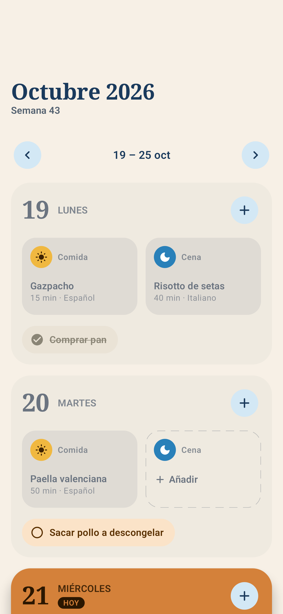
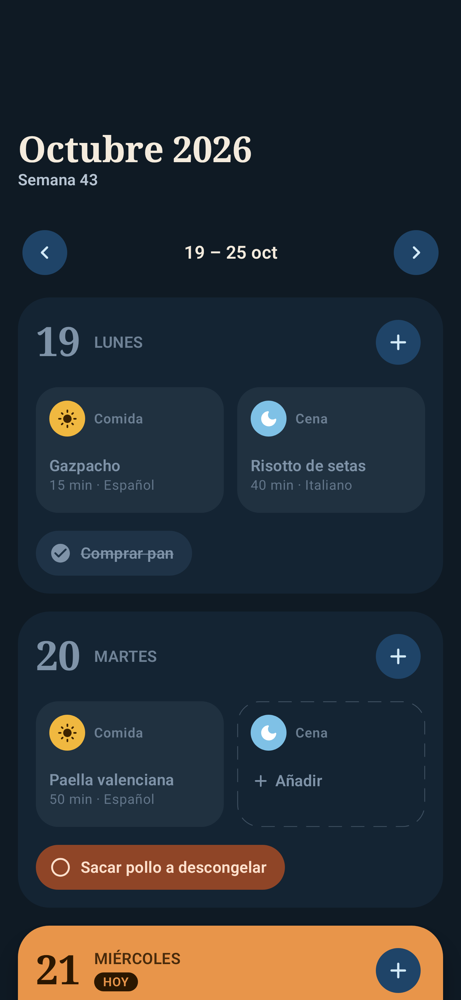
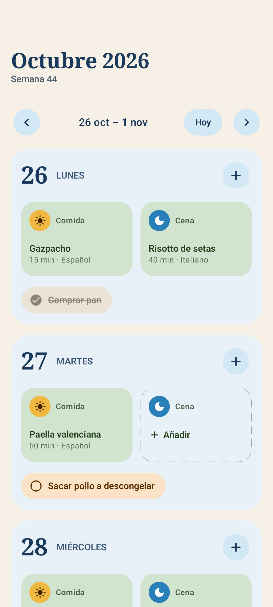
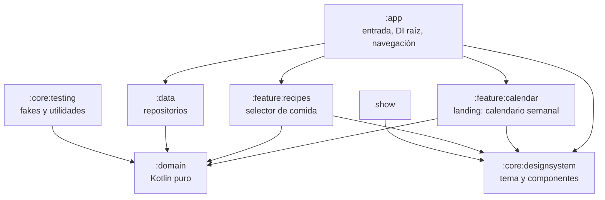
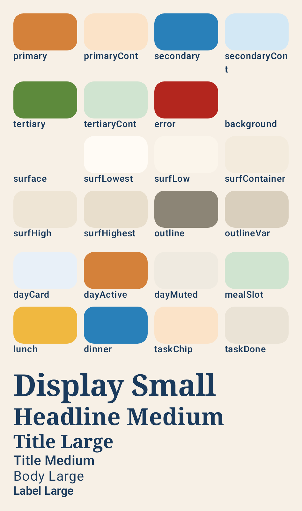
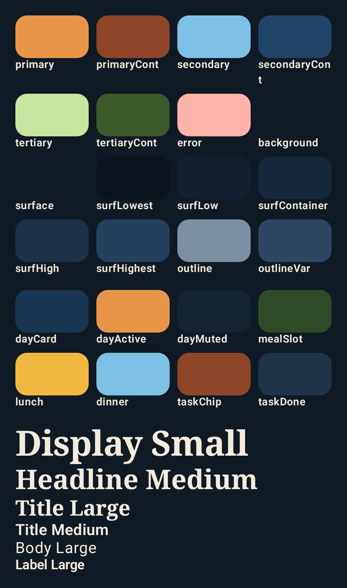
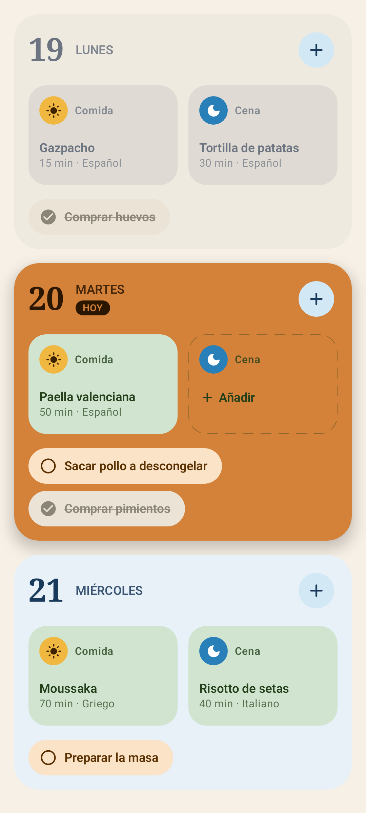

<div align="center">

# 🍽️ Tavola

**El planificador semanal de comidas para compartir en casa.**
Comida y cena de cada día, tareas rápidas y recetas propias, en una app Android nativa con el nuevo Material 3 Expressive.


-3DDC84?logo=android&logoColor=white)


</div>

<table>
  <tr>
    <td align="center"></td>
    <td align="center"></td>
    <td align="center"></td>
  </tr>
  <tr>
    <td align="center"><sub>Semana actual (claro)</sub></td>
    <td align="center"><sub>Semana actual (oscuro)</sub></td>
    <td align="center"><sub>Otra semana: aparece «Hoy»</sub></td>
  </tr>
</table>

> Las imágenes son las capturas de referencia de los tests de capturas del propio proyecto (ver [Tests](#-tests)), no maquetas.

---

## ✨ Qué es

Tavola está pensada para parejas, familias y compañeros de piso que deciden juntos qué comer. Cada día tiene:

- 🍴 **Comida y cena**, cada una con su receta.
- ✅ **Tareas rápidas** («sacar el pollo a descongelar», «comprar pimientos»).
- 📖 **Recetas propias** como tarjetas, con ingredientes y pasos.
- 🛒 **Lista de la compra** manual.

Identidad visual de **cocina mediterránea** (España, Italia, Grecia): cálida, orgánica y muy redondeada, con modo claro y oscuro diseñados a la vez.

### Estado actual

La app está en la **Fase 2 de 5** (ver [hoja de ruta](#-hoja-de-ruta)). Hoy funciona la pantalla de inicio con datos de ejemplo:

- 📅 Calendario semanal como pantalla de inicio, con la fecha real del dispositivo: el día de **hoy** se destaca, los **pasados** se apagan y los próximos tienen su propio color.
- ⬅️➡️ Navegación entre semanas pasadas y futuras, con botón **Hoy** para volver. El contenido se desliza hacia el lado correspondiente.
- ✔️ Marcar y desmarcar tareas y ➕ añadir tareas con un diálogo.
- 🍝 Elegir qué se come desde una **hoja inferior**: una receta del recetario (con buscador por título, etiqueta o ingrediente, sin tildes) o una **comida rápida** escrita a mano («sobras», «comemos fuera»…, con nota opcional). También se puede cambiar o quitar lo ya elegido.
- 🌗 Modo claro y oscuro, 🌍 textos en español e inglés.

> Los datos son **de ejemplo y viven en memoria**: se generan para cualquier semana y se pierden al cerrar la app. Firebase, grupos compartidos, el editor de recetas, la compra y la IA llegan en las fases siguientes.

---

## 🧱 Stack

| Área | Tecnología |
|---|---|
| Lenguaje | Kotlin 2.4 · Java 17 |
| UI | Jetpack Compose · **Material 3 Expressive** (`material3` 1.5.0-beta02, BOM 2026.09.00) |
| Arquitectura | Clean Architecture multi-módulo · MVVM con flujo unidireccional de datos |
| Navegación | **Navigation 3** (1.3.0-alpha03) con rutas serializables |
| Inyección de dependencias | Hilt 2.60 + KSP |
| Asincronía | Kotlin Coroutines y Flow · `kotlinx-datetime` |
| Build | Gradle 9.6 · AGP 9.5 · catálogo de versiones · plugins de convención (`build-logic`) |
| Calidad | Spotless + ktlint · Android Lint |
| Tests | JUnit 5 · Turbine · fakes (sin mocks) · Compose Preview Screenshot Testing |
| Previsto (Fases 3–5) | Firebase (Auth, Firestore, Storage, Messaging) · Coil · Claude API |

`minSdk` 26 · `compileSdk` y `targetSdk` 37.

---

## 🏗️ Arquitectura

### Módulos



| Módulo | Responsabilidad |
|---|---|
| `:app` | Punto de entrada (`@HiltAndroidApp`), navegación y barra flotante. **Único que conoce las rutas** y ensambla todo. |
| `:domain` | Kotlin puro (JVM, sin `android.*`): modelos (`PlannedMeal` —receta o comida rápida—, `Recipe` con ingredientes estructurados), interfaces de repositorio (`CalendarRepository`, `RecipeRepository`), `TodayProvider`, calificadores de dispatchers y utilidades de fechas. |
| `:data` | Implementaciones de los repositorios. Firestore: autenticación, grupos, recetas y calendario. Los módulos de Hilt son `internal`. |
| `:core:designsystem` | Tema, tokens y componentes base. Depende solo de Compose y Material 3, **nunca del dominio**. |
| `:core:testing` | Fakes (`FakeCalendarRepository`…), datos de ejemplo mediterráneos y `MainDispatcherExtension` para JUnit 5. |
| `:feature:calendar` | Una funcionalidad completa: `CalendarScreen`, `CalendarViewModel` y `CalendarUiState`. Aloja la hoja del selector, pero su contenido se lo cede `:app` por un *slot*. |
| `:feature:recipes` | El selector de comida (`MealPickerSheetContent`, `MealPickerViewModel`): busca recetas, anota comidas rápidas y escribe en el calendario a través del dominio. Crecerá con la lista y el editor de recetas. |

### Reglas de dependencia

- `:domain` no depende de nadie y el compilador impide que entre Android en él.
- `:data` depende de `:domain` e implementa sus interfaces: **inversión de dependencias**.
- Cada `:feature:*` depende de `:domain` y `:core:designsystem`, **nunca de otra feature**. Dos features se hablan por **identificadores y repositorios del dominio**, no entre sí: el calendario abre el selector (que le cede `:app` por un *slot*) y el selector escribe en el calendario a través de `CalendarRepository`.
- `:core:*` nunca depende de `:feature:*`.
- Una funcionalidad nueva es un módulo `:feature:<nombre>` nuevo.

### Capa de interfaz: MVVM con flujo unidireccional

```
 CalendarScreen ──acciones──▶ CalendarViewModel ──▶ CalendarRepository  (interfaz en :domain)
       ▲                            │                        ▲
       └────── StateFlow<UiState> ──┘                        │ implementa
                                                    InMemoryCalendarRepository  (en :data)
```

- El estado es un `StateFlow<CalendarUiState>` (`Loading` / `Success` / `Error`), expuesto con `stateIn(WhileSubscribed(5_000))` y leído con `collectAsStateWithLifecycle()`.
- La pantalla se divide en un punto de entrada con ViewModel (`CalendarScreen`) y una parte **sin estado** (`CalendarContent`) que recibe estado y acciones. Eso permite previsualizarla y probarla con capturas sin Hilt.
- Los casos de uso (`UseCase`) solo existen cuando combinan repositorios; si no, el ViewModel llama al repositorio directamente, siguiendo la [guía de arquitectura de Google](https://developer.android.com/topic/architecture/recommendations).

### Inyección de dependencias

- Hilt con inyección por constructor. Los `@Binds` de `:data` son `internal`.
- **Nunca `Dispatchers.IO` directo**: se inyectan `@IoDispatcher`, `@DefaultDispatcher` y `@MainDispatcher` (definidos en `:domain`), de modo que los tests puedan sustituirlos.
- La fecha de hoy es una dependencia (`TodayProvider`), así los tests fijan «hoy» y no dependen del reloj.

### Navegación

Navigation 3 con una sola `Activity`. Las rutas son `@Serializable` e implementan `NavKey`, y llevan solo identificadores simples. No hay menú de depuración ni pantalla de muestra: los datos de una persona son los de su grupo.

### Build

El build está centralizado para que añadir un módulo sea trivial:

- **Plugins de convención** en [`build-logic/`](build-logic): `tavola.android.application`, `tavola.android.library`, `tavola.android.compose.library` y `tavola.kotlin.jvm`.
- **`com.android.settings`**: `compileSdk`, `targetSdk` y `minSdk` se definen una sola vez en `settings.gradle.kts`.
- **Accesores tipados** (`projects.core.designsystem`) y catálogo de versiones en `gradle/libs.versions.toml`.
- **Spotless + ktlint** para todo el repositorio, con las reglas en `.editorconfig`.

---

## 🎨 Design system

Vive en `:core:designsystem` y se usa a través de `TavolaTheme` (nunca colores ni medidas sueltas en las pantallas).

<table>
  <tr>
    <td align="center"></td>
    <td align="center"></td>
    <td align="center"></td>
  </tr>
  <tr>
    <td align="center"><sub>Paleta (claro)</sub></td>
    <td align="center"><sub>Paleta (oscuro)</sub></td>
    <td align="center"><sub>Tarjeta de día: pasado, hoy, próximo</sub></td>
  </tr>
</table>

- **Color**: paleta mediterránea (azafrán, limón, egeo, albahaca, terracota…). Todos los roles de superficie y contenedor están definidos en claro y oscuro, y `dynamicColor` está desactivado. Los roles propios de Tavola (`TavolaTheme.colors`) cubren tarjetas de día, huecos de comida y chips.
- **Tipografía**: titulares en serif (carácter editorial) y texto de interfaz en sans-serif.
- **Formas**: muy redondeadas (8, 12, 16, 20 y 28 dp) y botones en píldora.
- **Movimiento**: `MotionScheme.expressive()` en todo el tema, y los componentes lo usan en vez de animaciones sueltas: resortes **espaciales** para tamaño, posición y forma (la hoja, el cambio de semana, las filas que se reordenan al buscar) y de **efectos** para color y opacidad. Las filas y botones responden al tacto.

| Componente | Qué hace |
|---|---|
| `TavolaScaffold` | Único scaffold permitido. Define la estrategia de *insets* (edge-to-edge) y oculta la barra flotante al hacer scroll. |
| `TavolaTopBar` | Barra superior grande y colapsable, con titular en serif. |
| `TavolaFloatingNavBar` | Navegación en píldora flotante, superpuesta al contenido. |
| `TavolaDayCard` | Tarjeta de día con tres estados (pasado, hoy, próximo) y estado «sin planificar». |
| `TavolaMealSlot` | Hueco de comida o cena, relleno o vacío (borde discontinuo), que anima el cambio entre ambos estados. |
| `TavolaTaskChip` | Tarea rápida que se marca y se tacha con animación. |
| `TavolaWeekSelector` | Flechas, rango de la semana y botón «Hoy». |
| `TavolaAddTaskDialog` | Diálogo para escribir una tarea. |
| `TavolaModalBottomSheet` | Hoja inferior con la forma y los colores del tema. |
| `TavolaSearchField` / `TavolaTextField` | Campos de texto en píldora, con botón de borrar animado. |
| `TavolaRecipeRow` | Fila de receta con respuesta táctil y estado seleccionado. |
| `TavolaLoadingIndicator` | Indicador de carga expresivo. |

Todos los componentes reciben **modelos de UI propios** y callbacks (no dependen del dominio) y llevan `@Preview` en claro y oscuro.

---

## 🧪 Tests

- **49 tests unitarios** con JUnit 5, Turbine y corrutinas de test: ViewModels del calendario y del selector, repositorios, buscador, formateo de fechas, utilidades de semana y el módulo de dispatchers.
- **Fakes en lugar de mocks**, como recomienda Google. Viven en `:core:testing` y se reutilizan en los tests del ViewModel.
- **44 capturas de referencia** con *Compose Preview Screenshot Testing* para componentes y pantallas, en móvil (claro y oscuro), plegable y tablet, y con texto grande para detectar recortes. Las referencias están en `app/src/screenshotTestDefaultDebug/reference`.

```bash
./gradlew testDebugUnitTest :domain:test :core:testing:test      # tests unitarios
./gradlew :app:testDebugScreenshotTestDefaultTestSuite           # compara las capturas
./gradlew :app:updateDebugScreenshotTestDefaultTestSuite         # regenera las referencias
```

> ⚠️ Los tests de capturas usan una API **experimental** y viven en `:app` (en una librería el motor falla al resolver las clases `R`). Las referencias se generaron en Windows: renderizarlas en otro sistema puede dar diferencias de fuente.

---

## 🤖 Integración continua

Cada push a `main` y cada pull request pasan por GitHub Actions ([`ci.yml`](.github/workflows/ci.yml)):

1. **Formato, lint y tests**: `spotlessCheck`, compilación de debug y release, `lintDebug` y todos los tests unitarios. Si algo falla, sube los informes como artefacto.
2. **Publicar APK** (solo en push a `main` y solo si lo anterior pasa): compila el APK de **debug**, lo firma con un keystore propio guardado como secreto del repositorio y crea una **pre-release `build-N`** con el APK adjunto (`tavola-0.1.N-debug.apk`). Se conservan las 10 últimas.

Para instalar una versión, abre la pre-release en la app de GitHub (o en el navegador del móvil) y descarga el APK. Como todas las builds llevan la misma firma y el número de versión sube en cada una, se instalan unas encima de otras. Si ya tenías la app instalada desde Android Studio, desinstálala una vez antes (la firma es distinta).

> Los tests de capturas **no** están en la CI todavía: sus referencias se generaron en Windows y habría que comprobarlas en Linux.

---
## 🚀 Empezar

**Requisitos:** Android Studio reciente, JDK 17 o superior (sirve el que trae Android Studio) y Android SDK 37.

```bash
git clone https://github.com/Jorhetfield/tavola.git
```

Abre la carpeta en Android Studio, haz *Sync* y ejecuta la configuración `app`. Entra con tu cuenta de Google y crea un grupo (o únete con un código): empieza con tres recetas de ejemplo.

Por línea de comandos (con `JAVA_HOME` apuntando a un JDK 17+):

```bash
./gradlew assembleDebug        # compilar
./gradlew spotlessApply        # formatear (ktlint)
./gradlew lintDebug            # lint de Android
```

---

## 📁 Estructura del repositorio

```
tavola/
├── app/                  entrada, navegación y tests de capturas
├── domain/               modelos e interfaces (Kotlin puro)
├── data/                 repositorios (hoy en memoria)
├── core/
│   ├── designsystem/     tema, tokens y componentes
│   └── testing/          fakes y utilidades de test
├── feature/
│   ├── calendar/         landing: calendario semanal
│   ├── recipes/          selector de comida (y, más adelante, recetario)
├── build-logic/          plugins de convención de Gradle
├── docs/                 plan, lecciones aprendidas e imágenes
└── CLAUDE.md             contexto y reglas del proyecto
```

---

## 🗺️ Hoja de ruta

| Fase | Contenido | Estado |
|---|---|---|
| 0 · Base | Catálogo de versiones, módulos, plugins de convención, strings es/en | ✅ |
| 1 · Design system | Tema, scaffold, barras y componentes del calendario | ✅ (pendiente el checkpoint visual en dispositivo) |
| 2 · Calendario con datos fake | Modelos, ViewModel, pantalla, selector de semana, selector de comida, tests | ✅ (pendiente el checkpoint en emulador) |
| 3 · MVP real | Firebase Auth, grupos con código de invitación, calendario en tiempo real, editor de recetas | ⏳ |
| 4 · Compra y diseño premium | Lista de la compra, fotos y carrusel de recetas, importar por URL, notificaciones | ⏳ |
| 5 · IA | Sugerencias por ingredientes, planificador semanal y sugerencias en la compra | ⏳ |

El detalle vive en [`docs/PLAN.md`](docs/PLAN.md).

---

## ⚠️ Decisiones y salvedades

- **Versiones preliminares a propósito**: AGP 9.5 RC, Material 3 1.5 beta, Navigation 3 alpha, Lifecycle 2.12 alpha y el motor de capturas en alpha. Se eligieron para tener Material 3 Expressive y los *test suites* de AGP; algunas APIs pueden cambiar.
- **`minSdk` 26**: `kotlinx-datetime` y `java.time` lo necesitan sin *desugaring*, y Android 8 cubre prácticamente todos los dispositivos.
- **Dependencias declaradas pero aún sin usar**: Firebase, DataStore y Coil están en el catálogo para las próximas fases; el *plugin* de `google-services` se activará al añadir `google-services.json`.
- **Tablet**: la pantalla funciona, pero las tarjetas de día se estiran a todo el ancho. El diseño adaptativo está pendiente hasta que la pantalla del calendario se estabilice.

---

## 🤝 Flujo de trabajo

- **`main` solo se actualiza con pull requests.** Cada trabajo nuevo va en una rama `feature/<nombre-corto>` creada desde `main` actualizado.
- La CI se ejecuta en cada pull request hacia `main`; al fusionar, publica la pre-release con el APK.
- Normas de código del proyecto: **sin `it` en las lambdas** (cada parámetro con un nombre legible) y **sin nombres de clase completos en mitad del código** (siempre `import` arriba).
- El detalle de estas normas está en [`CLAUDE.md`](CLAUDE.md).

---
## 📚 Documentación del proyecto

- [`CLAUDE.md`](CLAUDE.md): contexto, identidad visual, arquitectura y reglas de oro para trabajar con agentes de código.
- [`docs/PLAN.md`](docs/PLAN.md): hoja de ruta con el checklist por fases.
- [`docs/LESSONS.md`](docs/LESSONS.md): lecciones de la primera versión, para no repetir errores.
